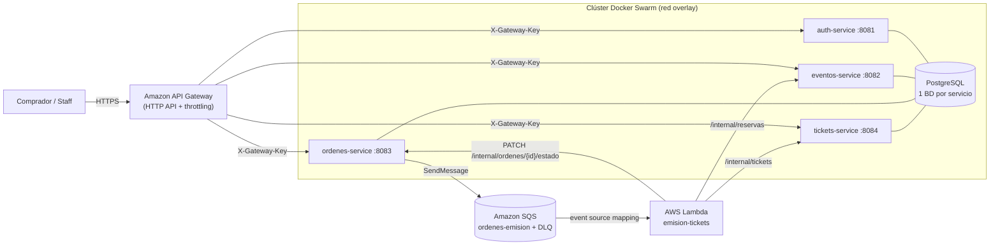
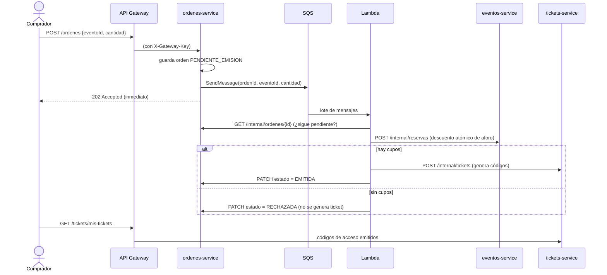

# Arquitectura de EventPass

## Visión general

## Flujo de compra (aceptación y emisión son procesos independientes)

## Cómo se cumple cada requerimiento del caso

| Requerimiento del caso | Solución |
|---|---|
| Autenticación y autorización por rol | `auth-service` emite JWT (HS256) con claim `rol`; cada servicio lo valida como *resource server* y restringe rutas por rol (`COMPRADOR`, `STAFF`). |
| Comprador consulta eventos y compra | `GET /eventos`, `POST /ordenes` (responde `202` al instante). |
| Comprador consulta códigos | `GET /tickets/mis-tickets`. |
| Staff valida códigos | `POST /tickets/validar` (solo `STAFF`). |
| Un código usado no puede reutilizarse | `UPDATE ... WHERE estado='EMITIDO'` atómico: el segundo intento recibe `409`. |
| Listado de eventos y aforo | `eventos-service` (`aforoTotal` / `aforoDisponible`). |
| Acceso solo por API Gateway | Rutas públicas únicamente en el gateway, que inyecta `X-Gateway-Key`; los servicios rechazan (`403`) lo que no la traiga. Las rutas `/internal/**` no existen en el gateway. |
| Aceptar orden ≠ emitir ticket | `ordenes-service` solo guarda y encola; la emisión ocurre en la Lambda. |
| No vender más que el aforo | Descuento atómico `UPDATE eventos SET disponible = disponible - n WHERE disponible >= n`; si afecta 0 filas, la orden se rechaza. |
| SQS + Lambda + microservicios | Cola `ordenes-emision` → Lambda → `eventos-service` (aforo) y `tickets-service` (código). |

## Garantías de consistencia

* **Idempotencia**: SQS entrega *al menos una vez*. Reservar aforo (clave `ordenId`), emitir tickets
  (`UNIQUE(ordenId, numero)`) y cambiar el estado de la orden pueden repetirse sin efectos duplicados.
* **Compensación**: si falla la emisión después de reservar, la Lambda libera los cupos.
* **Reintentos y DLQ**: la Lambda responde por mensaje (`ReportBatchItemFailures`); tras 5 intentos el
  mensaje pasa a `ordenes-emision-dlq` para su análisis.
* **Límite de concurrencia** de la Lambda (`MaxLambdaConcurrency`) para no saturar los microservicios.
